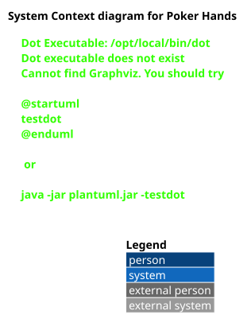

# 3. Context and Scope

## 3.1 System Boundary

The **Poker Hands** system is a single CLI process. Everything inside the boundary
is code this project owns and delivers. Everything outside is an actor or an
external system that interacts with it through well-defined interfaces.

Inside the boundary:
- Input parsing (hand notation → domain objects)
- Hand classification (domain objects → hand category + tiebreaker key)
- Hand comparison (two classified hands → winner or tie)
- Output formatting (result → human-readable string)

Outside the boundary:
- The human player who types or pipes input
- The automated acceptance test suite (pytest-bdd) that drives the CLI or calls
  public Python functions directly

There are no external services, databases, message buses, or network calls.

## 3.2 Context Diagram

The diagram below shows the system as a single box with its two external actors.

PlantUML source: [diagrams/c4-context.puml](diagrams/c4-context.puml)

## 3.3 External Interfaces

### Player → Poker Hands (stdin)

| Attribute | Detail |
|-----------|--------|
| Direction | Player → System |
| Channel   | stdin (interactive terminal or pipe) |
| Format    | One game per line: `<Name>: C1 C2 C3 C4 C5  <Name>: C1 C2 C3 C4 C5` |
| Card notation | Value: `2 3 4 5 6 7 8 9 T J Q K A`; Suit: `C D H S` |
| Example   | `Black: 2H 3D 5S 9C KD  White: 2C 3H 4S 8C AH` |

### Poker Hands → Player (stdout)

| Attribute | Detail |
|-----------|--------|
| Direction | System → Player |
| Channel   | stdout |
| Format    | `<Name> wins. - with <category>: <reason>` or `Tie.` |
| Example   | `White wins. - with high card: Ace` |

### Acceptance Test Suite → Poker Hands

| Attribute | Detail |
|-----------|--------|
| Direction | Test suite → System |
| Channel   | CLI subprocess (stdin/stdout) **or** direct Python function calls |
| Purpose   | Drives all ten hand categories, tie-breaking rules, and edge cases defined in the Gherkin feature files |
| Isolation | No network, no filesystem side-effects; every test run is hermetic |
