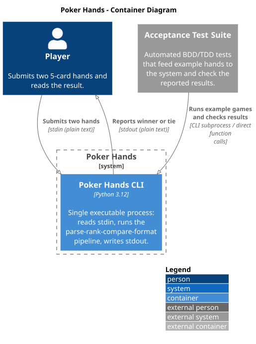
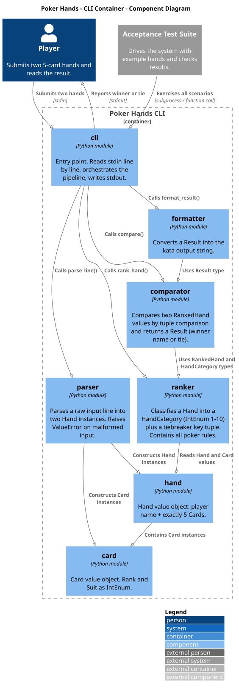

# 5. Building Block View

## 5.1 Level 1 — Container Diagram

Because the system is a single CLI process there is exactly one container.
The diagram below makes that explicit and shows how the two external actors
interact with it.

PlantUML source: [diagrams/c4-container.puml](diagrams/c4-container.puml)

## 5.2 Level 2 — Component Diagram (CLI Container)

The single container is decomposed into seven components that form the
parse → rank → compare → format pipeline described in Chapter 4.

PlantUML source: [diagrams/c4-component-cli.puml](diagrams/c4-component-cli.puml)

## 5.3 Component Descriptions

### `card` — Domain value objects (Card, Rank, Suit)

| Attribute | Detail |
|-----------|--------|
| Responsibility | Defines `Card` (an immutable dataclass of `Rank` × `Suit`), `Rank` (`IntEnum`, 2–A), and `Suit` (`IntEnum`, C/D/H/S). |
| Public interface | `Card(rank: Rank, suit: Suit)` |
| Dependencies | None |
| Key design rule | `Rank` is `IntEnum` so `Rank.ACE > Rank.KING` is a plain `>` comparison. |

### `hand` — Domain value object (Hand)

| Attribute | Detail |
|-----------|--------|
| Responsibility | Defines `Hand`: a named, immutable collection of exactly 5 `Card` instances. |
| Public interface | `Hand(player: str, cards: tuple[Card, ...])` |
| Dependencies | `card` |
| Key design rule | Construction validates that exactly 5 cards are present; raises `ValueError` otherwise. |

### `parser` — Input parsing

| Attribute | Detail |
|-----------|--------|
| Responsibility | Parses a raw input line into two `Hand` instances. |
| Public interface | `parse_line(line: str) -> tuple[Hand, Hand]` |
| Dependencies | `card`, `hand` |
| Key design rule | Raises `ValueError` with a descriptive message on any malformed input (wrong card count, unknown rank/suit token). |

### `ranker` — Hand classification

| Attribute | Detail |
|-----------|--------|
| Responsibility | Classifies a `Hand` into a `RankedHand`: a `HandCategory` (IntEnum, 1–9) plus a tiebreaker key (tuple of ints). |
| Public interface | `rank_hand(hand: Hand) -> RankedHand` |
| Dependencies | `card`, `hand` |
| Key design rule | Contains all poker rules. The tiebreaker key is constructed so that Python tuple comparison (`>`, `<`) resolves all ties without any special-case branching in the comparator. `ROYAL_FLUSH` is category 9 with an empty tiebreaker `()`. |

### `comparator` — Winner determination

| Attribute | Detail |
|-----------|--------|
| Responsibility | Accepts two `RankedHand` values and returns a `Result`: the winning player's name or a tie indicator. |
| Public interface | `compare(a: RankedHand, b: RankedHand) -> Result` |
| Dependencies | `ranker` (for `RankedHand`, `HandCategory`) |
| Key design rule | Comparison is a single tuple comparison `(category, tiebreaker_key)`. No poker rules live here. |

### `formatter` — Output formatting

| Attribute | Detail |
|-----------|--------|
| Responsibility | Converts a `Result` into the kata's required output string. |
| Public interface | `format_result(result: Result) -> str` |
| Dependencies | `comparator` (for `Result`) |
| Output examples | `White wins. - with high card: Ace` / `Black wins. - with full house: 4 over 2` / `Tie.` |

### `cli` — Entry point

| Attribute | Detail |
|-----------|--------|
| Responsibility | Reads lines from stdin, calls parser → ranker → comparator → formatter, writes each result to stdout. Handles top-level errors (malformed input) by printing an error message and continuing. |
| Public interface | `main()` (invoked by `python -m poker_hands` or a console-script entry point) |
| Dependencies | `parser`, `ranker`, `comparator`, `formatter` |

## 5.4 Dependency Rules

- Dependencies flow in one direction only: `cli` → `formatter` → `comparator` → `ranker` → `hand` → `card`.
- `parser` depends on `card` and `hand` but on nothing downstream.
- No circular dependencies are permitted.
- Domain modules (`card`, `hand`) have zero dependencies; they can be tested without importing any other project module.
