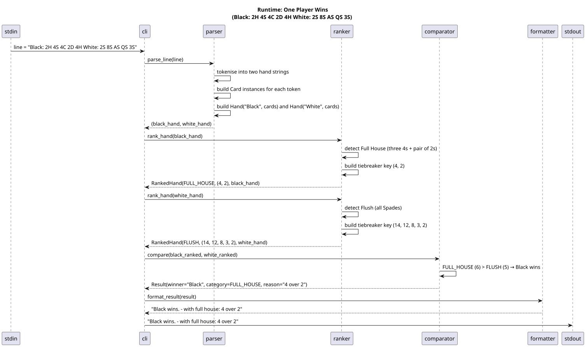
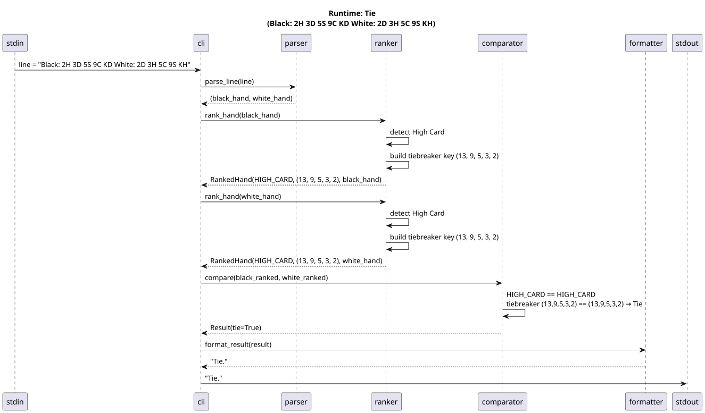
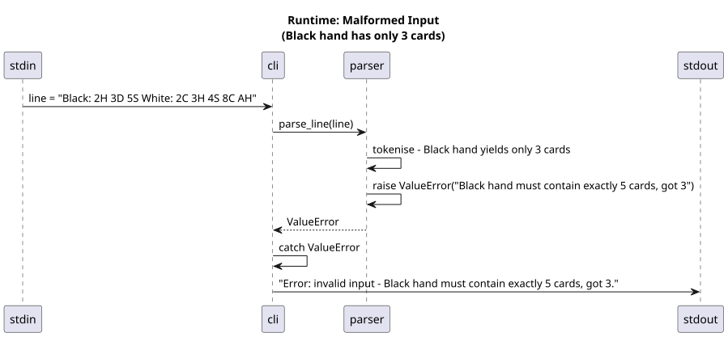

# 6. Runtime View

This chapter shows how the components interact at runtime for the two most
important scenarios: a normal game (one player wins) and a tie.
A third scenario covers malformed input, which is the main error path.

## 6.1 Scenario 1 — One Player Wins

Input line: `Black: 2H 4S 4C 2D 4H  White: 2S 8S AS QS 3S`
Expected output: `Black wins. - with full house: 4 over 2`

PlantUML source: [diagrams/seq-one-player-wins.puml](diagrams/seq-one-player-wins.puml)

## 6.2 Scenario 2 — Tie

Input line: `Black: 2H 3D 5S 9C KD  White: 2D 3H 5C 9S KH`
Expected output: `Tie.`

PlantUML source: [diagrams/seq-tie.puml](diagrams/seq-tie.puml)

## 6.3 Scenario 3 — Malformed Input

Input line: `Black: 2H 3D 5S  White: 2C 3H 4S 8C AH` (Black has only 3 cards)
Expected output: `Error: invalid input – Black hand must contain exactly 5 cards.`

PlantUML source: [diagrams/seq-malformed-input.puml](diagrams/seq-malformed-input.puml)
