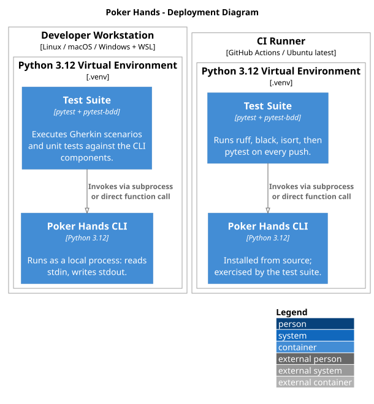

# 7. Deployment View

## 7.1 Overview

Poker Hands is a local CLI tool. There is no server, no cloud infrastructure,
and no network dependency. Deployment means installing Python and the test
toolchain on a developer's machine or a CI runner, then running the program
directly.

## 7.2 Deployment Diagram



PlantUML source: [diagrams/deployment.puml](diagrams/deployment.puml)

## 7.3 Environments

### Developer workstation

| Attribute | Detail |
|-----------|--------|
| OS | Any (Linux, macOS, Windows with WSL) |
| Python | 3.12 |
| Dependencies | `pytest`, `pytest-bdd` (dev-only); no runtime dependencies |
| Run program | `python3 -m poker_hands` or via console-script entry point |
| Run tests | `pytest` |
| Lint / format | `ruff check .`, `black --check .`, `isort --check .` |

### CI runner (e.g. GitHub Actions)

| Attribute | Detail |
|-----------|--------|
| OS | Ubuntu latest (or equivalent) |
| Python | 3.12 (pinned in workflow matrix) |
| Steps | Install dev dependencies → `ruff` → `black` → `isort` → `pytest` |
| Artefacts | Test report (JUnit XML); no build artefacts, no deployable image |
| Network access | None required at runtime; package install uses PyPI |

## 7.4 Installation Steps

```bash
# 1. Clone the repository
git clone <repo-url>
cd <repo>

# 2. Create and activate a virtual environment
python3 -m venv .venv
source .venv/bin/activate   # Windows: .venv\Scripts\activate

# 3. Install development dependencies
pip install pytest pytest-bdd

# 4. Run the test suite
pytest

# 5. Run the program interactively
python3 -m poker_hands
```

## 7.5 No Release Artefact

The kata produces no deployable artefact (no Docker image, no wheel published
to PyPI, no lambda package). The runnable output is the source tree itself,
executed directly with the Python interpreter.
